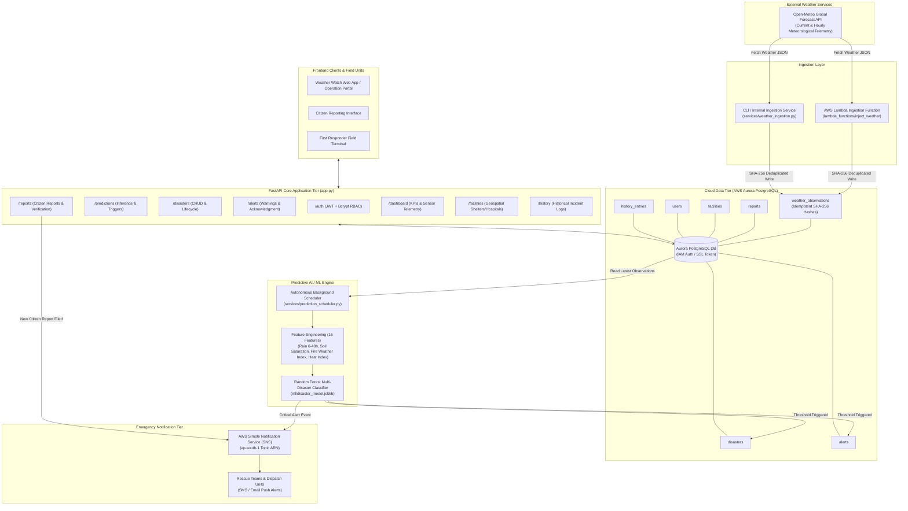

# Weather Watch - Cloud Disaster Response & Meteorological Early Warning System

[](https://fastapi.tiangolo.com/)
[](https://www.python.org/)
[](https://aws.amazon.com/rds/aurora/)
[](https://aws.amazon.com/lambda/)
[](https://aws.amazon.com/sns/)
[](https://scikit-learn.org/)

**Weather Watch** is an end-to-end, cloud-native meteorological early warning and disaster response backend. Built for the **Cloud Architecture Design** course, it combines serverless telemetry ingestion, machine learning-driven multi-hazard prediction, autonomous alert dispatching, citizen incident reporting, geospatial emergency infrastructure mapping, and role-based incident management.

---

## Table of Contents

- [System Architecture](#system-architecture)
- [Key Features & Subsystems](#key-features--subsystems)
  - [1. Serverless Weather Ingestion (AWS Lambda)](#1-serverless-weather-ingestion-aws-lambda)
  - [2. Multi-Hazard Machine Learning Engine](#2-multi-hazard-machine-learning-engine)
  - [3. Autonomous Background Prediction Scheduler](#3-autonomous-background-prediction-scheduler)
  - [4. Emergency Broadcast & Notifications (AWS SNS)](#4-emergency-broadcast--notifications-aws-sns)
  - [5. Citizen Incident Reporting & Workflow](#5-citizen-incident-reporting--workflow)
  - [6. Crisis Analytics & Telemetry Dashboard](#6-crisis-analytics--telemetry-dashboard)
  - [7. Geospatial Infrastructure & Facility Tracking](#7-geospatial-infrastructure--facility-tracking)
  - [8. Role-Based Authentication & Security (RBAC)](#8-role-based-authentication--security-rbac)
- [Data Models & Schema](#data-models--schema)
- [API Reference](#api-reference)
- [Environment Configuration](#environment-configuration)
- [Getting Started](#getting-started)
  - [Prerequisites](#prerequisites)
  - [Installation & Setup](#installation--setup)
  - [Database Seeding](#database-seeding)
  - [Running the Application](#running-the-application)
  - [Training the ML Model](#training-the-ml-model)
- [Default Seed Credentials](#default-seed-credentials)
- [Project Directory Structure](#project-directory-structure)

---

## System Architecture

The architecture leverages a hybrid cloud design: high-throughput serverless ingestion at the edge, persistent relational storage with IAM token authentication on AWS Aurora PostgreSQL, an asynchronous ML inference engine, and push notifications via AWS SNS.



---

## Key Features & Subsystems

### 1. Serverless Weather Ingestion (AWS Lambda)
- **Multi-Location Coverage**: Continuously polls Open-Meteo for major urban centers across India (`chennai`, `vellore`, `coimbatore`, `bengaluru`, `hyderabad`, `mumbai`, `delhi`, `kolkata`).
- **Idempotent Ingestion**: Computes a canonical SHA-256 hash of location, timestamp, and observation payload to prevent duplicate database writes.
- **Serverless Ready**: Packaged in [`lambda_functions/inject_weather/lambda_function.py`](file:///c:/Users/User/Documents/Adithya/College/College%20Year%203/Semester%201/Cloud%20Architecture%20Design/weather-watch-be/lambda_functions/inject_weather/lambda_function.py) for scheduled AWS EventBridge execution, with fallback execution via [`services/weather_ingestion.py`](file:///c:/Users/User/Documents/Adithya/College/College%20Year%203/Semester%201/Cloud%20Architecture%20Design/weather-watch-be/services/weather_ingestion.py).

### 2. Multi-Hazard Machine Learning Engine
- **Model Architecture**: Multi-class Random Forest Classifier trained on 12,000 meteorological simulation profiles.
- **Disaster Classes Handled**:
  - `None` (Normal Conditions)
  - `Flood`
  - `Landslide`
  - `Fire`
  - `Smoke`
  - `Building Collapse`
  - `Road Blockage`
- **16 Engineered Meteorological Features**:
  - Temperature, humidity, surface pressure, wind speed, real-time precipitation.
  - Cumulative rolling precipitation windows: `rain_6h_mm`, `rain_12h_mm`, `rain_24h_mm`, `rain_48h_mm`.
  - Trend vectors: Linear regression slope of precipitation and humidity trends.
  - Rapid barometric pressure drop (`pressure_delta_6h`).
  - Physical meteorological indices: Rothfusz **Heat Index**, Canadian-style **Fire Weather Index (FWI)**, and soil moisture-integrated **Soil Saturation Index**.
- **Demonstration / Simulation Capability**: Configurable `DEMO_MODE` and `demo_disaster` parameters allowing incident commanders to simulate emergency drill scenarios while strictly preserving authentic model probabilities.

### 3. Autonomous Background Prediction Scheduler
- **Asynchronous Lifecycle**: Spawns inside FastAPI's `lifespan` handler ([`services/prediction_scheduler.py`](file:///c:/Users/User/Documents/Adithya/College/College%20Year%203/Semester%201/Cloud%20Architecture%20Design/weather-watch-be/services/prediction_scheduler.py)), running concurrently without blocking incoming API traffic.
- **Database Driven**: Consumes latest recorded weather from `weather_observations` rather than hammering external weather APIs.
- **Autonomous Incident Creation**: When predicted probabilities cross risk thresholds (`Critical >= 0.60`, `High >= 0.35`, `Medium >= 0.15`), the pipeline automatically:
  1. Instantiates a new record in `disasters` with computed impact estimations (population at risk, road accessibility, water level risk).
  2. Generates a priority warning in `alerts`.
  3. Fires an urgent notification via AWS SNS.

### 4. Emergency Broadcast & Notifications (AWS SNS)
- Direct integration with AWS Simple Notification Service ([`services/notification_service.py`](file:///c:/Users/User/Documents/Adithya/College/College%20Year%203/Semester%201/Cloud%20Architecture%20Design/weather-watch-be/services/notification_service.py)).
- Immediately formats structured disaster payloads (disaster ID, hazard category, severity, coordinates, reporter) and publishes to `SNS_DISASTER_TOPIC_ARN`.
- Automatically dispatches notifications when:
  - Citizens submit verified crisis reports.
  - The ML pipeline predicts high/critical hazards.

### 5. Citizen Incident Reporting & Workflow
- Public reporting portal endpoint (`POST /reports`) accepting field reports with disaster type, severity, location, and description.
- **Rescue Acknowledgment Workflow**: Responders can claim and acknowledge reports (`PATCH /reports/{id}/acknowledge`), which logs responder credentials and timestamps.

### 6. Crisis Analytics & Telemetry Dashboard
- **Executive Summary (`/dashboard/summary`)**: Real-time counter of active incidents, severity breakdown (Critical, High, Medium), and cumulative population at risk.
- **Aggregate Analytics (`/dashboard`)**:
  - Hazard distribution by category (Flood, Fire, Landslide, etc.).
  - Severity classification distribution.
  - Multi-month incident timeline.
  - Regional population at risk distribution.
  - Disaster response operational status (`Active`, `Monitoring`, `Resolved`).
- **Environmental Telemetry (`/dashboard/telemetry`)**: Meteorological telemetry aggregator showing regional average temperature, humidity, counts of high-risk rainfall events, dangerous water levels, and top vulnerable regions.

### 7. Geospatial Infrastructure & Facility Tracking
- Manages vital emergency support infrastructure ([`routers/facilities.py`](file:///c:/Users/User/Documents/Adithya/College/College%20Year%203/Semester%201/Cloud%20Architecture%20Design/weather-watch-be/routers/facilities.py)):
  - Hospitals
  - Emergency Relief Shelters
  - Rescue Centers & Fire Stations
- Stores coordinates for distance calculations and resource dispatch.

### 8. Role-Based Authentication & Security (RBAC)
- Built on JSON Web Tokens (JWT) signed with SHA-256 (`HS256`) and password hashing via `bcrypt`.
- Enforces strict hierarchical roles:
  - **`Admin`**: Full control; manage disasters, update alert statuses, create facilities, inspect user databases.
  - **`Rescue Team`**: Operational control; run predictive pipelines, acknowledge alerts, claim citizen reports, view telemetry.
  - **`User` (Citizen)**: Field access; report disasters, view facilities, inspect verified public alerts.

---

## Data Models & Schema

The PostgreSQL schema is managed via SQLAlchemy ORM in [`db/models.py`](file:///c:/Users/User/Documents/Adithya/College/College%20Year%203/Semester%201/Cloud%20Architecture%20Design/weather-watch-be/db/models.py):

| Table | Description | Key Attributes |
|---|---|---|
| `users` | User credentials & RBAC | `id`, `username`, `email`, `hashed_password`, `role`, `full_name`, `created_at` |
| `disasters` | Active & historical disaster records | `id`, `type`, `location`, `latitude`, `longitude`, `severity`, `confidence`, `affectedArea`, `dryArea`, `populationAtRisk`, `status`, `timestamp`, `roadAccessibility`, `rainfall`, `temperature`, `humidity`, `waterLevel`, `aiSummary` |
| `alerts` | Broadcasted crisis alerts | `id`, `title`, `disasterId`, `type`, `severity`, `location`, `affectedArea`, `populationAtRisk`, `timestamp`, `acknowledged` |
| `reports` | Citizen incident submissions | `id`, `disasterType`, `location`, `submittedBy`, `timeAgo`, `status`, `severity`, `acknowledged`, `acknowledgedBy`, `acknowledgedAt` |
| `facilities` | Emergency response infrastructure | `id`, `name`, `type` (Hospital, Shelter, Rescue Center), `latitude`, `longitude` |
| `weather_observations` | Multi-station weather observations | `id`, `source`, `station_id`, `station_name`, `observed_at`, `fetched_at`, `temperature_c`, `rainfall_mm`, `humidity_pct`, `wind_speed_kmph`, `pressure_hpa`, `raw_data` (JSON), `record_hash` (Unique) |
| `history_entries` | Historical incident archive | `id`, `date`, `disaster`, `location`, `severity`, `affectedArea`, `status` |

---

## API Reference

### Authentication (`/auth`)
| Method | Endpoint | Access | Description |
|---|---|---|---|
| `POST` | `/auth/register` | Public | Register a new user account |
| `POST` | `/auth/login` | Public | Authenticate with username/password, returns JWT |
| `GET` | `/auth/me` | Authenticated | Fetch current user profile |
| `GET` | `/auth/users` | Admin | List all registered system users |

### Machine Learning Predictions (`/predictions`)
| Method | Endpoint | Access | Description |
|---|---|---|---|
| `POST` | `/predictions/run` | Rescue Team / Admin | Run full pipeline for custom lat/long, engineer features, create disasters/alerts, send SNS |
| `POST` | `/predictions/run-default` | Rescue Team / Admin | Run pipeline for configured default deployment city |
| `POST` | `/predictions/predict-only` | Rescue Team / Admin | Preview model prediction & class probabilities without DB writes or alerts |
| `GET` | `/predictions/latest` | Rescue Team / Admin | Retrieve the most recent in-memory prediction results |

### Disaster Management (`/disasters`)
| Method | Endpoint | Access | Description |
|---|---|---|---|
| `GET` | `/disasters` | Public | Filter disasters by `severity`, `type`, or `status` |
| `GET` | `/disasters/{id}` | Public | Retrieve detailed incident information |
| `POST` | `/disasters` | Admin | Create a new disaster record |
| `PATCH` | `/disasters/{id}/status` | Admin | Update incident status (`Active`, `Monitoring`, `Resolved`) |
| `DELETE` | `/disasters/{id}` | Admin | Remove an incident record |

### Alerts (`/alerts`)
| Method | Endpoint | Access | Description |
|---|---|---|---|
| `GET` | `/alerts` | Rescue Team / Admin | List all current crisis alerts |
| `POST` | `/alerts` | Admin | Issue a new manual emergency alert |
| `POST` | `/alerts/{id}/acknowledge` | Rescue Team / Admin | Acknowledge and claim an alert |

### Incident Reports (`/reports`)
| Method | Endpoint | Access | Description |
|---|---|---|---|
| `GET` | `/reports` | Authenticated | List all submitted citizen reports |
| `POST` | `/reports` | Authenticated | Submit an incident report (triggers SNS dispatch) |
| `PATCH` | `/reports/{id}/acknowledge` | Rescue Team / Admin | Mark report as acknowledged with responder ID & timestamp |

### Dashboard & Telemetry (`/dashboard`)
| Method | Endpoint | Access | Description |
|---|---|---|---|
| `GET` | `/dashboard/summary` | Public | Active disaster totals, severity breakdown, population at risk |
| `GET` | `/dashboard` | Public | Categorical, severity, timeline, and regional chart analytics |
| `GET` | `/dashboard/telemetry` | Public | Sensor telemetry, weather readings, water/rainfall hazard metrics |

### Emergency Facilities (`/facilities`)
| Method | Endpoint | Access | Description |
|---|---|---|---|
| `GET` | `/facilities` | Authenticated | List all emergency shelters, hospitals, and rescue centers |
| `POST` | `/facilities` | Admin | Register new emergency infrastructure |

### Historical Archive (`/history`)
| Method | Endpoint | Access | Description |
|---|---|---|---|
| `GET` | `/history` | Public | Retrieve past disaster timeline records |

---

## Environment Configuration

Configure application settings by creating a `.env` file in the project root:

```ini
# --- AWS Aurora PostgreSQL Connection ---
DB_USER=postgres
DB_HOST=weather-watch-db.cluster-xxxxxx.ap-south-1.rds.amazonaws.com
DB_PORT=5432
DB_NAME=weatherwatch
AWS_REGION=ap-south-1

# --- Security / JWT ---
JWT_SECRET_KEY=your-secure-random-32-byte-secret-key

# --- AWS Simple Notification Service (SNS) ---
SNS_DISASTER_TOPIC_ARN=arn:aws:sns:ap-south-1:123456789012:weather-watch-disaster-alerts

# --- Background Scheduler & Simulation ---
PREDICTION_INTERVAL_SECONDS=7200
DEMO_MODE=true
DEMO_OVERRIDE_PROBABILITY=0.60

# --- Default Monitoring Coordinates (Chennai) ---
WEATHER_LATITUDE=13.0827
WEATHER_LONGITUDE=80.2707
WEATHER_LOCATION_ID=Chennai, Tamil Nadu
```

---

## Getting Started

### Prerequisites
- **Python 3.12+**
- **PostgreSQL** or **AWS Aurora PostgreSQL** instance
- **AWS CLI** configured with credentials having access to RDS and SNS (if testing AWS services)

### Installation & Setup

1. **Clone the repository**:
   ```bash
   git clone https://github.com/Nachi2006/weather-watch-be.git
   cd weather-watch-be
   ```

2. **Create and activate a virtual environment**:
   ```bash
   python -m venv .venv
   # Windows (PowerShell)
   .\.venv\Scripts\Activate.ps1
   # Linux / macOS
   source .venv/bin/activate
   ```

3. **Install dependencies**:
   ```bash
   pip install -r requirements.txt
   ```

### Database Seeding
Initialize database tables, default RBAC users, active disasters, facilities, and historical data:
```bash
python seed.py
```

### Running the Application

Start the FastAPI application with Uvicorn:
```bash
# Using main.py
python main.py

# Or directly with uvicorn
uvicorn app:app --host 0.0.0.0 --port 8000 --reload
```

Once running, access the interactive API docs:
- **Swagger UI**: [http://127.0.0.1:8000/docs](http://127.0.0.1:8000/docs)
- **ReDoc**: [http://127.0.0.1:8000/redoc](http://127.0.0.1:8000/redoc)

### Training the ML Model
To retrain the Random Forest multi-disaster prediction classifier on synthetic meteorological scenarios:
```bash
python -m ml.train_disaster_model
```
This generates an updated model artifact serialized to `ml/disaster_model.joblib`.

### Running Weather Ingestion Manually
To execute a manual ingestion cycle across all monitored cities:
```bash
python -m services.weather_ingestion
```

---

## Default Seed Credentials

When `seed.py` is executed, the following pre-configured credentials are created for development and evaluation:

| Role | Username | Password | Intended Use |
|---|---|---|---|
| **Admin** | `admin` | `AdminPassword123!` | Incident management, user inspection, infrastructure configuration |
| **Rescue Team** | `rescueteam` | `RescuePassword123!` | ML pipeline execution, alert acknowledgement, field reports |
| **User** | `citizen` | `UserPassword123!` | Public citizen report submissions, alert checking |

---

## Project Directory Structure

```text
weather-watch-be/
│
├── app.py                           # FastAPI application entrypoint & lifespan management
├── main.py                          # Uvicorn startup runner script
├── models.py                        # Pydantic request / response schemas
├── requirements.txt                 # Pinned project dependencies
├── pyproject.toml                   # Project metadata and dependencies specification
├── seed.py                          # Database initialization & mock data seeder
│
├── db/                              # Database layer
│   ├── db.py                        # Engine, session factory & Aurora IAM auth connector
│   ├── models.py                    # SQLAlchemy ORM database models
│   └── test_db.py                   # DB connectivity sanity check
│
├── lambda_functions/                # Serverless cloud functions
│   └── inject_weather/
│       └── lambda_function.py       # Multi-city weather ingestion AWS Lambda handler
│
├── ml/                              # Machine Learning core
│   ├── disaster_model.joblib        # Serialized Random Forest multi-hazard model artifact
│   ├── flood_risk_model.joblib      # Serialized flood risk model artifact
│   ├── train_disaster_model.py      # Synthetic training data generator & model trainer
│   ├── predict.py                   # Flood prediction inference utility
│   └── ml_test_prediction.py        # ML testing script
│
├── routers/                         # FastAPI REST route controllers
│   ├── auth.py                      # /auth endpoints (register, login, profile, user list)
│   ├── disasters.py                 # /disasters CRUD and lifecycle management
│   ├── alerts.py                    # /alerts crisis notifications and acknowledgment
│   ├── reports.py                   # /reports citizen incident reporting & SNS dispatch
│   ├── dashboard.py                 # /dashboard KPIs, distributions & telemetry insights
│   ├── predictions.py               # /predictions manual triggers & model previews
│   ├── facilities.py                # /facilities emergency shelters and hospitals
│   └── history.py                   # /history historical disaster timeline
│
└── services/                        # Business logic & background pipelines
    ├── auth.py                      # Password hashing, JWT token issue/decode, user seeding
    ├── security.py                  # OAuth2 bearer dependencies & RBAC role guards
    ├── disaster_prediction.py       # Multi-disaster inference pipeline & demo mode
    ├── feature_engineering.py       # 16-parameter meteorological feature calculator
    ├── flood_prediction.py          # Legacy flood prediction adapter
    ├── prediction_alert_pipeline.py # End-to-end inference, DB persistence & SNS trigger
    ├── prediction_scheduler.py      # Async background multi-city scheduler
    ├── weather_ingestion.py         # Open-Meteo multi-city fetcher & SHA-256 deduplication
    ├── weather_client.py            # HTTP client for Open-Meteo API
    ├── notification_service.py      # AWS SNS publishing service
    ├── dashboard.py                 # Aggregations for telemetry & KPI metrics
    ├── disasters.py                 # Disaster database queries & mutations
    ├── alerts.py                    # Alert formatting and acknowledgment operations
    ├── reports.py                   # Report creation and response tracking
    ├── facilities.py                # Facilities query and creation operations
    ├── history.py                   # Historical records query
    └── time_utils.py                # ISO datetime formatting & relative time calculators
```

---

## License

This project is licensed under the MIT License — see the [LICENSE](LICENSE) file for details.
